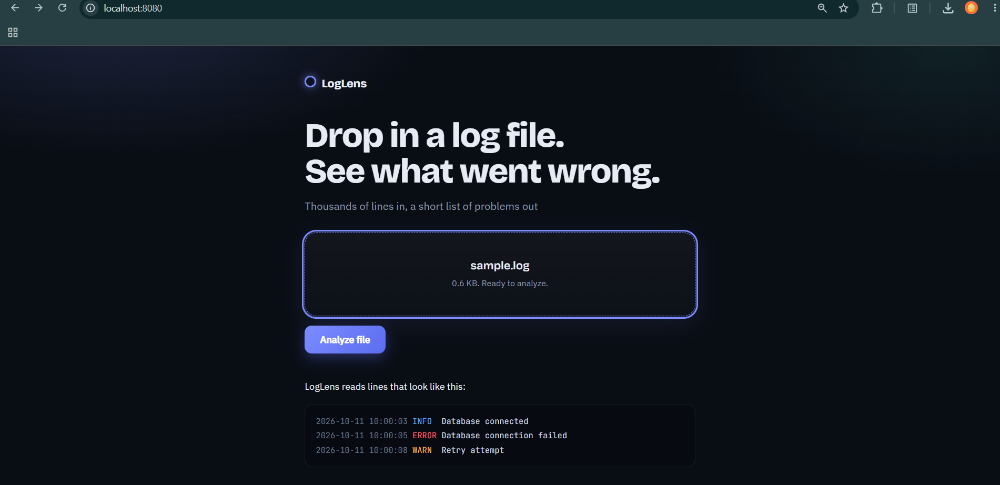
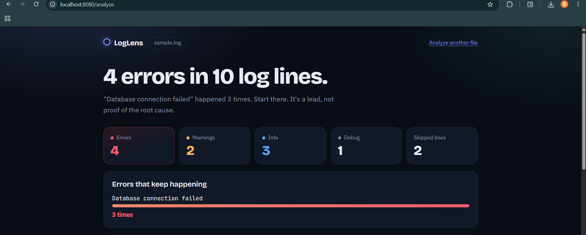
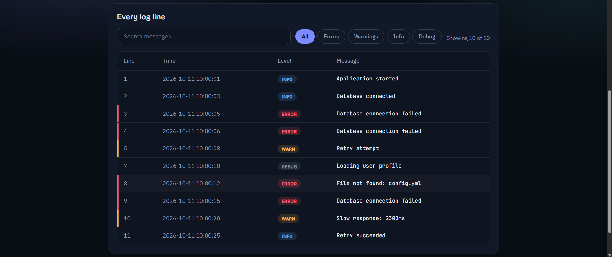

# LogLens

LogLens is a web application that analyzes application log files. Upload a `.log` or `.txt` file and get a summary of what happened: counts per severity level, repeated error messages, and a searchable, filterable list of every log entry.

## Features

- Upload a `.log` or `.txt` file (up to 5 MB)
- Summary counts for errors, warnings, info and debug entries
- Detection of repeated error messages, ranked by how often they occur
- Search by keyword and filter by severity level
- Validation messages for empty, oversized or unsupported files
- Unit tests for the parser, analyzer and service

## Tech Stack

- Java 17
- Spring Boot 3.5 (Spring Web)
- Thymeleaf, HTML, CSS, JavaScript
- JUnit 5
- Maven

## Log Format

```
2026-10-11 10:00:05 ERROR Database connection failed
```

Supported levels: `INFO`, `WARN`, `ERROR`, `DEBUG`.

## Getting Started

Requirements: JDK 17 or newer and Maven.

```bash
git clone https://github.com/<your-username>/loglens.git
cd loglens
mvn spring-boot:run
```

Open http://localhost:8080 and upload `sample.log` from the project folder.

Run the tests:

```bash
mvn test
```


## Screenshots




